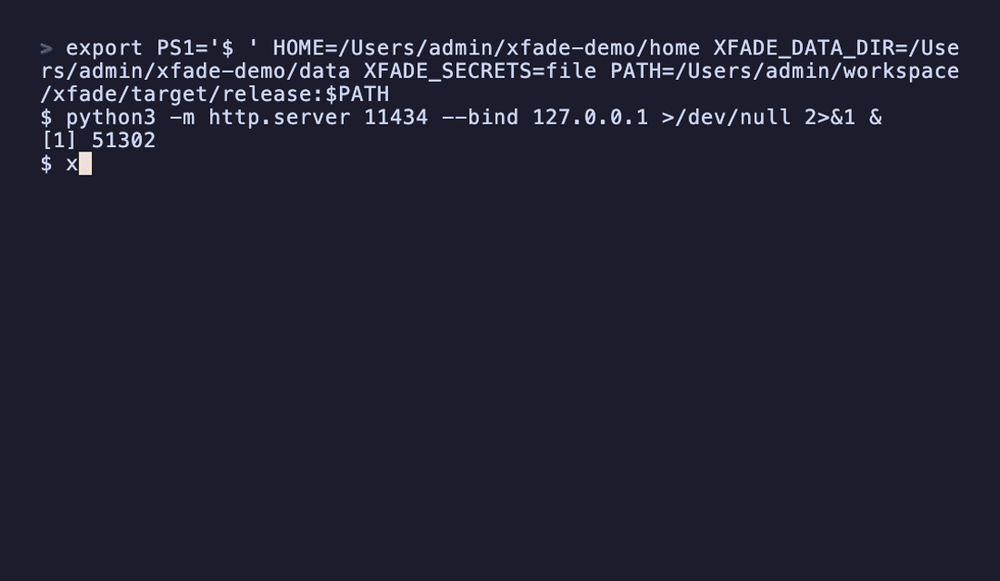

# xfade

English | [简体中文](README.zh-CN.md)

Switch API providers between AI coding tools like Claude Code / Codex / OpenCode / Pi / Oh My Pi / Aider / Cline / Hermes Agent / OpenClaw, with a local proxy (OpenAI/Anthropic-compatible endpoints, failover, protocol conversion) and a macOS/Linux resident daemon.

CLI (`xfade`) + Tauri GUI, implemented in Rust.



## Features

- **TUI**: bare `xfade` opens a crossfader-style TUI — per-tool tabs, provider health badges, parallel probe-all, and inline edit; falls back to a plain list when stdout is not a terminal.
- **Provider switching**: add/remove/edit providers for Claude Code / Codex / OpenCode / Pi / Oh My Pi / Aider / Cline / Hermes Agent / OpenClaw, one-command switch writes each tool's config (settings.json / config.toml+auth.json / opencode.json / .aider.conf.yml / .cline/data/settings/ / .hermes/config.yaml / .openclaw/openclaw.json), stores keys in the system keyring, auto-backs-up before switching.
- **Local proxy**: `xfade serve` exposes OpenAI/Anthropic-compatible endpoints (`/v1/chat/completions`, `/v1/messages`, `/v1/responses`, `/v1/models`) with route failover, circuit breaking, token stats, and request logs.
- **Protocol conversion**: bidirectional Anthropic↔OpenAI conversion (`target_protocol`), decoupling clients from the upstream protocol.
- **daemon (macOS + Linux)**: launchd/systemd-resident + boot autostart + crash restart; `/__xfade/status` admin endpoint.
- **GUI**: Tauri desktop app, five pages (Providers / Proxy / Stats / Logs / Settings) + system tray (close-to-tray, quick switch, start/stop proxy); `xfade` self-installs the daemon as a sidecar.

## Installation

### CLI

```bash
# Homebrew (recommended, macOS)
brew install xfade-dev/xfade/xfade

# or the one-line installer (macOS / Linux)
curl -fsSL https://xfade.sh | sh

# or download a binary from GitHub Release
# or build from source
cargo build --release -p xfade   # output target/release/xfade
```

### GUI

Download `xfade-gui_<version>_aarch64.dmg` (macOS Apple Silicon) from GitHub Release and drag it into Applications. Or build from source — see "Development" below.

## Quick start

```bash
# 1. Add a third-party provider (Codex as an example)
xfade add kimi --tool codex --base-url https://api.moonshot.cn/v1 --key sk-xxx

# 2. Switch to it (writes ~/.codex/config.toml + auth.json, auto-backs-up the old config)
xfade use kimi --tool codex

# 3. Show the current provider
xfade current --tool codex
```

Tip: run bare `xfade` to open the interactive TUI and switch providers with arrow keys / fader.

Claude Code supports per-slot models — pin a different model for each of the
`opus` / `sonnet` / `haiku` slots (written as `ANTHROPIC_DEFAULT_*_MODEL`):

```bash
xfade add work --tool claude --base-url https://... --key sk-xxx \
  --opus-model deepseek/deepseek-v4-pro \
  --sonnet-model deepseek/deepseek-v4-flash \
  --haiku-model deepseek/deepseek-v4-flash
```

Same for the other tools: `--tool claude-code|codex|open-code|pi|oh-my-pi|aider|cline|hermes|openclaw`.

### One-off run without switching

`xfade run` launches the tool with a provider injected through environment
variables only — no config files are written or touched, so the active setup
stays exactly as-is:

```bash
xfade run kimi            # launch claude against kimi for this session only
xfade run kimi -- --print # everything after `--` goes to the tool itself
```

Supported for env-driven tools (claude, aider); config-file tools tell you to
use `xfade use` instead. Official providers launch the tool as-is.

### Instant launch: `xfade <tool>`

The tool name itself is a subcommand — a shorthand for `xfade run` with the
provider, model, endpoint and key resolved on the spot (unregistered presets
are auto-created; nothing is ever written into the tool's own config):

```bash
xfade claude kimi                          # launch Claude Code on the kimi preset (auto-created)
xfade claude --model kimi-k2.5             # no name: the model reverse-looks-up a matching preset/provider
xfade claude my-gw --base-url https://gw --key sk-xxx   # ad-hoc endpoint, auto-registered
xfade claude -- --print                    # everything after `--` goes to the tool
xfade aider deepseek --model deepseek-chat
xfade codex glm --model glm-5-2-260617     # -c config overrides + key via env (no files touched)
xfade opencode glm -- run "fix the bug"    # inline OPENCODE_CONFIG_CONTENT (no files touched)
```

Notes:

- Key precedence: `--key` → the provider's stored key → the global `api_key`.
- `--model` / `--base-url` are one-off overrides and are never persisted.
- Injection works for **claude** and **aider** (env), **codex** (`-c`
  overrides + `XFADE_CODEX_KEY` referenced via `env_key`) and **opencode**
  (inline `OPENCODE_CONFIG_CONTENT`) — codex/opencode verified 2026-10-22
  against codex-cli 0.155.0 / opencode 1.18.31 (real config homes stay
  untouched). pi ignores env overrides for custom providers, so pi (and
  omp/cline/hermes/openclaw) point at `xfade use` instead.

## Session view

Requests flowing through `xfade serve` get a conversation identity: the
opener (system + first user turn) is hashed into a fingerprint, and
consecutive turns within 30 minutes reuse the same session — no prompt text
is ever stored (only a truncated opener preview). Model switches made by
`xfade use` or `xfade proxy use --model` land on the session timeline and are
backfilled from the next matching request:

```bash
xfade sessions                 # list recent sessions (tool / provider / tokens / status)
xfade sessions show <id>       # one session + its model-switch timeline
xfade stats --by session       # request/token aggregates per session
```

Every proxied response also carries an `X-Xfade-Session-Id` header.

## CLI command reference

```
xfade add <id> --tool <t> [--base-url URL] [--key KEY] [--set 'json']
xfade ls [--tool <t>]
xfade use <id> --tool <t>
xfade run <id> [--tool <t>] [-- <args>]  # launch the tool with the provider injected (claude / aider / codex / opencode)
xfade <tool> [name] [--model M] [--base-url U] [--key K] [-- <args>]
                                        # instant launch: claude/aider/codex/opencode work; other tools point at `use`
xfade current --tool <t>
xfade edit <id> --tool <t> [--base-url URL] [--key KEY] [--set 'json']
xfade rm <id> --tool <t>
xfade presets                     # list built-in presets for all tools
xfade import --tool <t>            # import from the tool's existing config
xfade backup ls|restore --tool <t>
xfade completion <shell>
xfade tui [--tool <t>]             # interactive crossfader TUI (default: bare `xfade`)
xfade sessions [show <id>]         # unified session view (conversations seen by the proxy)
xfade config [set <k> <v>]         # view/set global config (secrets backend, shared base_url/model/api)
xfade self-update                  # update to the latest GitHub release
```

### Local proxy

```bash
xfade serve [--port 24860] [--host 127.0.0.1] [--auth-token T]   # run in foreground
xfade proxy use --routes yy,bak [--model-override gpt-x] [--target-protocol chat|messages]
xfade proxy status
xfade proxy clear
xfade proxy smart on|off              # Smart Fader toggle (off by default)
xfade stats [--by provider|model|session]   # aggregate request stats
```

### Smart Fader (intent-aware routing)

Off by default — enable with `xfade proxy smart on`; every request pays zero extra cost while off.

When on, the proxy classifies each request's last user message (pure keyword rules, no model calls) and re-orders your configured routes across tiers:

| Intent | Examples | Order |
|---|---|---|
| Light — error triage, tests, lint/format, small refactors | "why does this fail", "write a test", "run clippy" | local first, cloud fallback |
| Heavy — big refactors, architecture | "restructure the module", "design the API" | cloud first, local fallback |
| Unknown | anything unmatched | configured order (unchanged) |

Details:

- **Tier detection**: explicit `extra.tier = "local" | "cloud"` on a provider wins; otherwise loopback base_urls (`127.0.0.1`/`localhost`/`[::1]` — Ollama, LM Studio, MLX servers) are local, everything else cloud.
- **In-bucket ordering**: within a tier, providers are ordered by recent health (error rate, then latency) from a 30s-TTL stats snapshot — no per-request GROUP BY. Providers without stats keep their configured position relative to each other.
- **Circuit breakers and failover behave exactly as with the fader off**: open circuits are skipped before bucketing, and a failing primary still fails over through the list.
- Model overrides now also apply on the chat→chat passthrough path (local runtimes): the `model` field is rewritten per route.
- Project analysis (language fingerprint + git pulse, cached in the `repo_maps` table) surfaces through `xfade project`, a serve-startup prewarm of the cwd, and the latest repo map shown in `xfade proxy status`. Phase-2 classification itself only reads the prompt text.

### daemon (macOS + Linux)

```bash
xfade serve install [--port --host --auth-token]   # install as launchd-resident + boot autostart
xfade serve status                                 # query run state / routes / circuits
xfade serve uninstall                              # uninstall
```

Logs: `~/.config/xfade/serve.log`.

## GUI

```bash
cd crates/gui && npx tauri dev    # development
```

Left-sidebar pages:

- **Providers**: CRUD / switch / import / backups.
- **Proxy**: control the daemon (start/stop), edit route failover, circuit status.
- **Stats**: 24h/7d/30d × provider/model aggregation.
- **Logs**: the latest 200 request logs.
- **Settings**: global config (secrets backend, shared base_url/model/api, global API key).

System tray: close-to-tray, start/stop proxy, per-tool quick switch, quit. GUI autostarts on boot. The GUI embeds the `xfade` sidecar, so it can self-run `serve install` (no CLI pre-install needed).

## Environment contract

- `HOME`: tool config root.
- `XFADE_DATA_DIR`: self data dir (db/backups/daemon.json/config.json), defaults to `$HOME/.config/xfade`.

### Secret storage backend

The secret backend applies to **all tools** and is resolved with this priority:

1. `XFADE_SECRETS` env (`file` | `keyring`)
2. `XFADE_MOCK_SECRETS=1` (alias for `file`, tests/back-compat)
3. `<data_dir>/config.json` `secrets` field
4. default: system keyring

To persist the choice (no env var needed, applies to every tool):

```bash
xfade config                 # view current backend
xfade config set secrets file     # → ~/.config/xfade/config.json {"secrets":"file"}
xfade config set secrets keyring  # back to the system keychain
```

`secrets: file` stores API keys in `secrets.json` (owner-only 0600), which avoids the
macOS keychain authorization prompt that an ad-hoc-signed dev build triggers on every
rebuild. `keyring` uses the system keychain (recommended for signed release builds).

### Shared "general" config (all tools)

`config.json` also holds shared defaults — like CC Switch's general config — so you
set `base_url` / `model` / `api_key` / `api` once and every tool reuses them:

```bash
xfade config set base_url http://your-gateway:3000
xfade config set model glm-5-2-260617
xfade config set api anthropic-messages  # Pi/OMP wire protocol (optional)
xfade config set api_key sk-xxx        # stored in the secret backend, not config.json
xfade config                            # view all (api_key is masked)

xfade add glm --tool claude             # no --base-url/--key/--set → inherits the above
xfade use glm --tool claude
```

When `add` omits `--base-url` (non-interactive), it falls back to the global `base_url`
(use `--official` to force official login instead). An omitted `--key` falls back to the
global `api_key`; an omitted model falls back to the global `model`. A provider's
explicit values always win over the globals.

`api` selects Pi/OMP's wire protocol (`openai-completions` default, or
`anthropic-messages`). This matters for gateways like new-api/BM TokenHub whose OpenAI
streaming emits a trailing empty `choices` chunk that breaks `finish_reason` parsing —
switching to `anthropic-messages` sidesteps it.

CLI and GUI share the same data dir and backend, and can be used at the same time.

## Development

Rust workspace: `crates/core` (library) + `crates/cli` (`xfade`) + `crates/gui/src-tauri` (Tauri).

```bash
cargo test                       # full test suite
cargo clippy --all-targets --workspace -- -D warnings
cd crates/gui && npm install && npx tauri dev   # GUI dev (build the sidecar first)
bash crates/gui/build-sidecar.sh               # build the xfade sidecar into binaries/
```

See [docs/architecture.md](docs/architecture.md), [docs/getting-started.md](docs/getting-started.md), [docs/api.md](docs/api.md), [CHANGELOG.md](CHANGELOG.md), [RELEASE.md](RELEASE.md).

## License

MIT OR Apache-2.0
